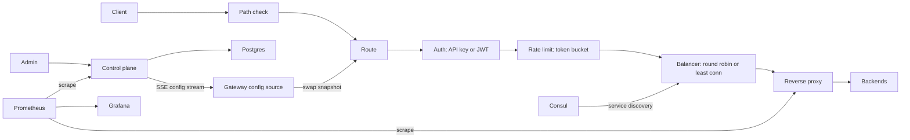

# Tollgate

Tollgate is a traffic gateway written in Go. It runs as two separate parts. The data plane (`cmd/gateway`) carries client traffic. The control plane (`cmd/controlplane`) stores versioned route configs in Postgres and pushes each new version to the gateways. The gateway reverse-proxies requests to upstream backends. It balances them with round-robin or least-connections, and it runs active and passive health checks. It limits each client with a hand-written token bucket and checks API keys or JWTs. Backends can come from static lists or from Consul service discovery. Config changes apply with hot reload and no restart. The gateway exports Prometheus metrics, and the repo includes a Grafana dashboard.

## Architecture



The **data plane** is the gateway. It handles every client request. It never calls the control plane on the request path. It holds the active config in an atomic pointer. When a new config version arrives, it builds a new snapshot and swaps it in. Requests in flight finish on the old snapshot.

The **control plane** is the admin REST API. It writes each change as a new version in Postgres and publishes that version to connected gateways over Server-Sent Events (SSE).

If the control plane is down, the gateway keeps serving its last applied config. It can also restore that config from a local file after a restart (`-lkg-path`). See ADR 0001 and ADR 0005.

## Quick start

You need Docker with Compose v2. Run these commands from the repo root. Everything is published on `127.0.0.1` only.

```sh
make up        # builds the images and starts the demo stack; waits until it is ready
```

On the author's laptop, `make up` took 52.4 s from cold (including image builds) and 17.2 s warm.

Try the gateway. The `api` route needs the demo API key. **The key is DEMO-ONLY.**

```sh
# Public route (the "web" route, path /): no auth
curl -s 127.0.0.1:8080/

# Authenticated route (the "api" route, path /api) with the DEMO-ONLY key: 200
curl -s -o /dev/null -w '%{http_code}\n' -H 'X-API-Key: demo-api-key-tollgate-0001' 127.0.0.1:8080/api/x

# Same route without a key: 401
curl -s -o /dev/null -w '%{http_code}\n' 127.0.0.1:8080/api/x

# Rate-limited burst: 30 rapid requests. Expect 200s, then 429s.
for i in $(seq 30); do curl -s -o /dev/null -w '%{http_code}\n' -H 'X-API-Key: demo-api-key-tollgate-0001' 127.0.0.1:8080/api/x; done | sort | uniq -c
```

Change the config through the admin API. The admin token is **DEMO-ONLY**. This adds a route `hello` at `/hello` with a limit of 1 request per second and a burst of 1. The route is public (`auth` defaults to none), so the limit is per client IP.

```sh
ADMIN='DEMO-ONLY-admin-token-0123456789abcdef-change-me'

# Add the route (201 on create). Wait about a second for it to apply.
curl -s -o /dev/null -w '%{http_code}\n' -X PUT -H "Authorization: Bearer $ADMIN" \
  -d '{"path_prefix":"/hello","upstream":"demo-static","rate_limit":{"requests_per_second":1,"burst":1}}' \
  127.0.0.1:9000/v1/routes/hello
sleep 1

# Two quick requests: 200, then 429 once the new limit applies
curl -s -o /dev/null -w '%{http_code}\n' 127.0.0.1:8080/hello
curl -s -o /dev/null -w '%{http_code}\n' 127.0.0.1:8080/hello

# Remove it again (204)
curl -s -o /dev/null -w '%{http_code}\n' -X DELETE -H "Authorization: Bearer $ADMIN" 127.0.0.1:9000/v1/routes/hello

# Which gateways are connected to the control plane
curl -s -H "Authorization: Bearer $ADMIN" 127.0.0.1:9000/v1/dataplanes; echo
```

Other demo endpoints:

| What | URL | Notes |
|---|---|---|
| Gateway admin (health, readiness, metrics) | `http://127.0.0.1:8081/healthz`, `/readyz`, `/metrics` | Admin listener, no auth |
| Prometheus | `http://127.0.0.1:9091` | |
| Grafana | `http://127.0.0.1:3000` | Anonymous Viewer access. Admin login is DEMO-ONLY (`DEMO-ONLY-grafana-admin` unless `GRAFANA_ADMIN_PASSWORD` is set). |
| Consul UI | `http://127.0.0.1:8500` | Dev agent |

`make demo` runs a short scripted tour of the same features once the stack is up.

Stop the stack and delete its volumes:

```sh
make down      # docker compose down -v
```

The demo credentials are in `deploy/compose/demo.env` and `deploy/compose/seed.yaml`. They are for local use only.

## Measured results

Everything below was measured on one laptop. The load generator ran on the same VM as the gateway, so these numbers do not describe a production setup. The run used the Docker VM with 8 vCPUs. k6 was pinned to CPUs 0-2, the gateway to CPUs 3-5, and everything else to CPUs 6-7. The run was on battery power, and the host had 87% of its swap in use (4431 of 5120 MB). RESULTS.md warns about both. The commit was `b80a38349c90aa68561f226833cf531513a93241`, with no tracked-file changes. The only gateway changes since that commit are one log-field limit and a comment; nothing on the request path changed. See [bench/results/RESULTS.md](bench/results/RESULTS.md) for the full tables, the host and VM details, and the run provenance.

| Measurement | Result | Caveat |
|---|---|---|
| Added latency, p50, access log off | median +0.113 ms (min..max 0.103 .. 0.154 ms) | Noise floor 0.038 ms. The delta is above it. |
| Added latency, p50, access log on | median +0.192 ms (min..max 0.167 .. 0.222 ms) | Noise floor 0.038 ms (from the access-log-off A/A rounds). |
| Max throughput, direct to backend | >= 16000 rps (ceiling not found) | Top tested step passed. |
| Max throughput, gateway to 1 backend | 12000 rps quoted; not monotonic | 12000 rps passed in 3 of 3 runs. 14000 failed in 1 of 3 runs. 16000 passed in 3 of 3. The tool caps the quoted figure at 12000. At 16000 rps the gateway used 0.9 CPU cores (of 3 pinned). |
| Max throughput, gateway to 3 backends | >= 16000 rps (ceiling not found) | Top tested step passed. |
| Rate limiter, single key | 1599 allowed, expected 1600.1, error -0.07% | 100 rps, burst 100, each key offered 2x for 15 s. |
| Rate limiter, 4 keys in parallel | error min / median / max = -0.09% / -0.07% / -0.06% | Same setup. |
| Rate limiter, polite key | 750 requests, 0 rejected | Checks isolation only. |
| Hot reload, config changes | 100 changes (90 route PUTs, 10 rollbacks) in a 58 s load window | 300 rps fast traffic and 100 rps slow traffic. |
| Hot reload, requests | 23314 total; 0 non-2xx; 0 connection errors | 5150 requests spanned at least one change, and 0 of them failed. |
| Hot reload, propagation p50 | 4.0 ms lower bound, 7.0 ms upper bound | Clock resolution 1 ms; each figure includes about one request round trip. |
| Failover | See the table below | Killed backend or backend answering 500. 3 runs per case. |

Failover, min / median / max over 3 runs each. "Failed in first cluster" is the number of client requests that failed in the first failure cluster. "Back in rotation" is measured from the restore.

| Case | Failover time (s) | Failed in first cluster | Back in rotation (s) |
|---|---|---|---|
| active-fail500 | 0.040 / 0.040 / 0.042 | 3 / 3 / 3 | 3.349 / 4.748 / 5.551 |
| active-kill | 1.023 / 1.028 / 1.034 | 4 / 4 / 4 | 2.493 / 2.682 / 3.743 |
| consul-fail500 | 0.041 / 0.041 / 0.046 | 3 / 3 / 3 | 4.358 / 8.551 / 9.558 |
| consul-kill | 2.020 / 2.027 / 2.034 | 69 / 69 / 69 | 0.764 / 1.585 / 1.983 |
| passive-fail500 | 0.036 / 0.041 / 0.041 | 3 / 3 / 3 | 2.946 / 4.346 / 6.351 |
| passive-kill | 0.025 / 1.022 / 1.027 | 3 / 4 / 4 | 3.225 / 3.267 / 9.533 |

The three failover upstreams all use passive health: a backend is ejected after 3 consecutive failed requests, with a 10 s cool-off. `fo-active` adds active checks. `fo-consul` adds Consul discovery plus active checks. See `deploy/compose/bench.yaml`. The regimes:

- **Backend answers 500 (all three configs).** The backend is ejected after 3 failed requests, about 0.04 s at 200 rps.
- **Backend killed, static backends (`passive-kill`, `active-kill`).** 3-4 requests fail. The gateway dials these backends by name. Docker's DNS stops resolving a killed container's name, so each dial fails at once with `no such host`, and ejection takes tens of milliseconds. The failover time of about 1.02 s in the table is one request that was mid-dial and waited for the 1 s dial timeout that the benchmark sets. One `passive-kill` run had no such request, and its failover time was 0.025 s.
- **Backend killed, Consul-discovered backends (`consul-kill`).** 69 requests fail and failover takes about 2.03 s. The gateway reaches these backends by IP address. A killed container's IP silently drops packets, so every dial waits the full 1 s dial timeout. Passive ejection counts a failure when the request completes. Two requests failed at once; with those, the first dial timeout, about 1 s after the kill, is the third consecutive failure and ejects the backend. Every request sent to it before then fails after waiting 1 s: 67 of the 69 failures took about 1000 ms (logs and a script in [bench/results/evidence/failover-kill](bench/results/evidence/failover-kill/README.md)).

This is a limit of the current design. A backend that drops packets costs about one dial timeout of failed requests. A shorter `timeouts.dial` shrinks the window. The benchmark uses 1 s, and the default is 2 s. Retrying on another backend would hide it, but retries are not implemented.

A backend that keeps failing causes a user-visible failure about once per 10 s cool-off. After each cool-off the gateway sends one real client request to it, and that request fails. This continues for as long as the backend stays broken.

**What these numbers do not show:**

- One machine. The load generator, gateway, control plane, Postgres, Consul and backends share one Docker VM.
- The load generator shares the VM with the system under test.
- These are not a production capacity claim.
- Two targets have no ceiling. For direct and 3-backend throughput, the top step passed, so the real maximum is higher than the quoted number.

## Design decisions

| ADR | Title | Decision |
|---|---|---|
| [0001](docs/adr/0001-control-plane-data-plane-split.md) | Split Tollgate into a control plane and a data plane | The gateway never calls the control plane on the request path. |
| [0002](docs/adr/0002-atomic-swap-vs-rwmutex.md) | Hot reload with an atomically swapped immutable snapshot | Requests read the config through an atomic pointer. A new version is built off to the side and swapped in. |
| [0003](docs/adr/0003-round-robin-vs-least-connections.md) | Round-robin and least-connections, selectable per upstream | Each upstream chooses its algorithm in config. |
| [0004](docs/adr/0004-token-bucket-vs-sliding-window.md) | A hand-written token bucket per (route, client) | Rate limits use a token bucket written in this repo. |
| [0005](docs/adr/0005-config-push-vs-poll.md) | Push config to data planes over Server-Sent Events | The control plane pushes each version to gateways over SSE. |
| [0006](docs/adr/0006-health-checking-active-and-passive.md) | Active probes plus passive ejection | Active probes and 5xx-based passive ejection both run. |
| [0007](docs/adr/0007-service-discovery-consul.md) | Discover backends with Consul blocking queries in the data plane | Each gateway watches Consul directly with blocking queries. |
| [0008](docs/adr/0008-versioned-config-store.md) | Store configs as full-document snapshots in one append-only Postgres table | Each write stores the whole config as a new version. |
| [0009](docs/adr/0009-what-counts-as-a-backend-failure.md) | Classify backend failures at the round trip, not in the ErrorHandler | Only real backend outcomes count against a backend. Client errors and pre-routing rejections do not. |
| [0010](docs/adr/0010-discovery-readiness-and-flap-protection.md) | Discovery readiness gate, carry-over and a backend grace period | Readiness waits for the first Consul answer. A removed backend keeps its state for a grace period. |
| [0011](docs/adr/0011-upstream-connection-pool.md) | Upstream connection pool: a large per-backend idle pool, no connection cap, and a 100 ms flush | Idle connections are kept per backend. There is no connection cap. Known-length responses flush every 100 ms. |

## Repository layout

- `cmd/gateway`: the data plane binary.
- `cmd/controlplane`: the control plane binary (admin API, config stream, Postgres store).
- `internal/config`: config model, validation, and the file and remote config sources.
- `internal/proxy`: request path, snapshot build, hot reload, and the reconcile loop.
- `internal/balancer`: backends, the registry, round-robin and least-connections.
- `internal/health`: active probes and passive ejection.
- `internal/ratelimit`: the token bucket.
- `internal/auth`: API key and JWT authenticators, and the client IP key.
- `internal/discovery`: the Consul watcher.
- `internal/controlplane`: admin API handlers, the versioned store (Postgres and in-memory), migrations, and the SSE hub.
- `internal/metrics`: Prometheus collectors and the access log.
- `deploy/`: Dockerfile, Compose files, Kubernetes manifests (`deploy/k8s`), Prometheus and Grafana config, and the demo upstream binary.
- `bench/`: k6 scripts, benchmark and chaos scripts, and results (`bench/results/RESULTS.md`).
- `docs/`: architecture, ADRs, progress log and learning notes.
- `.github/workflows/ci.yml`: CI.
- `.claude/agents/`: agent definitions used to build the project.

## Development

```sh
make test         # go vet ./... and go test -race ./...
make cover        # coverage for internal/; fails under 80%. 94.4% in CI (with Postgres), 90.8% locally without it.
make lint         # golangci-lint v2.15.0 (local binary, or the Docker image). Local run: 0 issues.
make bench-test   # unit tests for the benchmark analysis scripts (no Docker needed)
```

The Postgres store tests need a database. They read `TOLLGATE_TEST_DATABASE_URL` and skip when it is not set. The Consul integration test reads `TOLLGATE_TEST_CONSUL_ADDR` in the same way.

The Go version is set in `go.mod` (`go 1.26.9`).

**CI** (`.github/workflows/ci.yml`) has four jobs:

- `lint`: golangci-lint v2.15.0.
- `test`: runs `go vet`, the Python benchmark unit tests, and `go test -race` with Postgres and Consul services. It fails if coverage of `internal/` is under 80%.
- `build`: builds both binaries.
- `image`: builds the gateway, controlplane and demo images. It does not push.

Every job passed on the first run on GitHub, with the Postgres and Consul integration tests running against the service containers.

## Deploy

- **Docker Compose:** `make up` (see Quick start). The stack has the gateway, control plane, Postgres, Consul, three demo backends, Prometheus and Grafana.
- **Kubernetes:** kind manifests are in `deploy/k8s/`. Follow [deploy/k8s/README.md](deploy/k8s/README.md). The kind cluster maps `127.0.0.1:8080`, which clashes with Compose. Run `make down` before you create the cluster.

## Benchmarks

```sh
make bench-all            # bench + chaos, about 45 minutes (the recorded run took 39). Needs Docker.
SMOKE=1 make bench-all    # about 5 minutes. Proves the scripts work. Do not quote its numbers.
make bench                # overhead, max throughput, limiter (about 26 minutes)
make chaos                # hot reload and failover, 6 cases x 3 runs (about 18 minutes)
```

Smoke runs write to `bench/results/smoke/`. For a valid run, plug in AC power and keep the machine awake. The full method and its caveats are in [bench/README.md](bench/README.md).

## Known limits

From `docs/architecture.md` section 10.1, plus one from section 9:

- **No TLS between the planes.** Tokens and configs cross the cluster network in clear text. mTLS is future work.
- **The admin listener is unauthenticated.** It exposes route names, backend IDs, rates and status codes, and it accepts no writes. It must stay inside the cluster (section 9). `-pprof` adds profiling with no auth, and it is off by default.
- **No retries to another backend.** A dial failure becomes a 502, even when another backend is healthy. A backend that drops packets (for example, a killed container's IP) costs about one dial timeout of failed requests (see Failover).
- **X-Forwarded-For is not trusted.** The client key for rate limiting is `RemoteAddr`. Clients behind one NAT or one load balancer share one bucket.
- **Rate limits are per gateway instance.** With R replicas, a client can get up to R times the rate.
- **No per-backend concurrency ceiling.** A slow backend is handled only by timeouts and least-connections.
- **No panic mode.** If every backend of an upstream is down, the upstream answers 503.
- **The failed-auth throttle can lock out a NAT.** Ten failed attempts from one client key block valid credentials from that key until tokens refill.
- **One shared data-plane token.** Any holder can read configs and post status for any node ID.
- **Multi-replica control plane is eventually consistent.** Replicas converge within one head-poll interval (2 s by default).

## Docs index

- [docs/architecture.md](docs/architecture.md): the system map, request path, config flow and known limits.
- [docs/adr/](docs/adr/): architecture decision records 0001-0011.
- [docs/progress.md](docs/progress.md): build log, including the bugs the reviews found.
- [docs/todo-manual.md](docs/todo-manual.md): what was not done and what still needs a person.

## How this was built

The owner planned the project in `PLAN.md`. AI agents implemented it under an orchestrator. Each phase followed test-first development, and an independent reviewer checked each phase's diff. `docs/progress.md` records what the reviews found, including the bugs they caught and how they were fixed.
